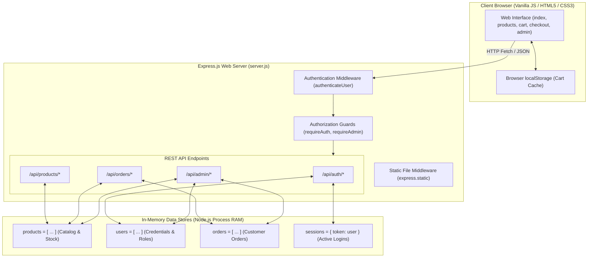

# 🎓 Full Stack E-Commerce Shopping Website — Project Report

---

## 1. Project Abstract

The **Full Stack E-Commerce Shopping Website** is a responsive web application engineered to simulate real-world e-commerce interactions. Developed for academic mini-project coursework, it demonstrates the fundamental principles of full-stack client-server architecture using only four foundational web technologies: **HTML5**, **CSS3**, **Vanilla JavaScript**, and **Express.js (Node.js)**. 

To satisfy the pedagogical objective of understanding backend routing, session management, and state manipulation without external configuration dependencies, the application utilizes **in-memory JavaScript arrays and objects** for data persistence. The system provides customer workflows including product catalog browsing, keyword search, category filtering, persistent shopping cart management, stock validation, and order placement via Cash on Delivery (COD). In addition, it features an authenticated Administrator Dashboard allowing store managers to inspect revenue metrics, perform inventory CRUD (Create, Read, Update, Delete) operations, and manage order fulfillment lifecycles.

---

## 2. Problem Statement

Modern full-stack web applications often introduce complex database configuration procedures (such as configuring MongoDB connection URIs, MySQL daemon services, or Docker containers) and heavy frontend frameworks (React, Angular, Next.js). For undergraduate students learning web development fundamentals, these layers frequently obscure core concepts such as:
1. HTTP request/response cycles.
2. State synchronization between client and server.
3. Server-authoritative data recalculation versus client-side presentation.
4. Role-based authorization mechanisms.

Furthermore, existing basic classroom demonstrations often lack visual polish, responsive design, or business rule validation (such as stock depletion and order integrity). There is a distinct need for a full-stack e-commerce project that is visually professional, feature-rich, and functionally complete while remaining strictly self-contained with zero external database or framework overhead.

---

## 3. Project Objectives

The primary objectives of this project are:
- **Foundational Architecture**: Build a functional e-commerce web platform using solely HTML5, CSS3, Vanilla JS, and Express.js.
- **Server-Authoritative Business Logic**: Ensure that critical calculations (item pricing, inventory quantities, total order values) are validated on the backend rather than trusting client-provided values.
- **In-Memory Data Modeling**: Model database collections using native JavaScript structures (`products[]`, `users[]`, `orders[]`, and `sessions{}`) to demonstrate data operations without database installations.
- **Role-Based Authorization**: Implement authentication and role checks to separate regular customers from administrative operations.
- **Modern User Experience**: Deliver an attractive, responsive user interface utilizing modern CSS variables, glassmorphism, responsive grid layouts, and user feedback mechanisms (toasts, modals).
- **Academic Clarity**: Maintain clean, readable, modular code that a student can easily explain during Viva Voce examinations.

---

## 4. Existing System vs. Proposed System

| Feature / Aspect | Existing Traditional Mini-Projects | Proposed System (This Project) |
| :--- | :--- | :--- |
| **Frontend Frameworks** | Often uses heavy React/Angular setups or bare HTML with inline styles. | Clean, semantic **HTML5** and modern **CSS3** design system with modular Vanilla JavaScript. |
| **Database Dependency** | Requires active MySQL/MongoDB local service or cloud cluster connection strings. | **Zero database installation**: Operates entirely in memory via Express.js arrays, running instantly on any machine with Node.js. |
| **Pricing & Total Security** | Browser calculates totals and posts them directly to server (insecure). | **Server recalculates all prices and subtotals** against authoritative backend arrays; browser values are never trusted. |
| **Stock Management** | Static display of items with no real inventory deduction. | **Atomic stock decrements** upon order placement; prevents ordering beyond available stock levels. |
| **Cart Persistence** | Cart resets when navigating between pages. | **Dual-layer cart**: Cached in browser `localStorage` and re-verified on the server for live stock and price changes. |
| **Administrative Control** | Buttons simply hidden using CSS; APIs accessible by anyone. | **True backend authorization middleware** (`requireAdmin`) returning `403 Forbidden` for unauthorized actors. |
| **Design & Responsiveness** | Dated table-based layouts; poorly formatted for mobile devices. | Fully responsive mobile/tablet/desktop layouts with clean typography, modals, and toast alerts. |

---

## 5. Software and Hardware Requirements

### 5.1 Software Requirements
- **Operating System**: Windows 10/11, macOS, or Ubuntu Linux.
- **Runtime Environment**: Node.js (v16.0.0 or higher recommended; developed and tested on Node.js v24.x).
- **Package Manager**: npm (Node Package Manager).
- **Core Dependencies**: Express.js (`express: ^4.21.2`), Cookie Parser (`cookie-parser: ^1.4.7`).
- **Code Editor**: Visual Studio Code (or any modern IDE).
- **Web Browser**: Any modern evergreen browser (Google Chrome, Mozilla Firefox, Microsoft Edge, Safari).

### 5.2 Hardware Requirements
- **Processor**: Intel Core i3 / AMD Ryzen 3 or higher.
- **RAM**: Minimum 2 GB (4 GB or higher recommended).
- **Disk Space**: Less than 50 MB required for project files and `node_modules`.
- **Display Resolution**: 1024×768 or higher (supports all mobile and widescreen resolutions).

---

## 6. System Architecture

The application adopts a **Client-Server 2-Tier Architecture**:
1. **Presentation Layer (Frontend)**: Static HTML5 documents, CSS3 stylesheets (`style.css`, `responsive.css`), and Vanilla JavaScript controllers executing in the client browser.
2. **Application & Logic Layer (Backend)**: Express.js web server handling HTTP routing, session verification, business logic, stock deductions, and serving client assets from the `/public` directory.
3. **In-Memory Storage (Data Layer)**: Native JavaScript collections residing in Node.js process memory.

### Architecture Diagram (Mermaid)

---

## 7. Module Descriptions

### 7.1 Customer Module (`index.html`, `products.html`, `product-details.html`)
- **Homepage**: Features an animated promotional hero banner, category quick links, and dynamic featured products loaded from `/api/products?limit=8`.
- **Catalogue**: Displays products in Indian Rupees (₹) with real-time text search, category filtering (Electronics, Clothing, Footwear, Accessories, Home and Lifestyle), and price sorting.
- **Product Details**: Displays comprehensive product specifications, customer rating stars, remaining warehouse inventory, and quantity selection controls constrained by available stock.

### 7.2 Shopping Cart & Checkout Module (`cart.html`, `checkout.html`, `cart.js`, `checkout.js`)
- **Cart Management**: Allows users to increment, decrement, and remove items. Persists data across browser refreshes using `localStorage`.
- **Server Validation**: The `/api/products/validate-cart` endpoint audits client cart items against server-side prices and live inventory, adjusting quantities or emitting warnings if stock has decreased.
- **Checkout Process**: Collects shipping information (Full Name, 10-digit mobile number, street address, city, state, 6-digit PIN code) and Cash on Delivery (COD) confirmation.
- **Stock Decrement**: Atomically reduces product stock upon order creation and assigns a unique identifier (`ORD-YYYYMMDD-XXXX`).

### 7.3 Authentication & Session Module (`login.html`, `register.html`, `auth.js`)
- **User Registration**: Creates customer accounts with input sanitization, password hashing via Node.js `crypto` SHA-256, and duplicate email prevention.
- **Session Management**: Issues cryptographically secure 64-character random tokens stored in an in-memory session object and sent via HttpOnly cookies and response headers.
- **Role Distinction**: Differentiates between `customer` and `admin` roles.
- **Demo Helper**: One-click filler buttons on the login interface to populate test credentials (`admin@eshop.com` and `customer@eshop.com`).

### 7.4 Customer Orders Module (`orders.html`, `orders.js`)
- Displays order history specifically belonging to the authenticated user.
- Shows item details, total expenditure, shipping addresses, and status badges (`Pending`, `Processing`, `Shipped`, `Delivered`, `Cancelled`).

### 7.5 Administrator Dashboard Module (`admin.html`, `admin.js`)
- **Analytics Metrics**: Real-time counters displaying Total Inventory Products, Total Customer Orders, Gross Store Revenue, and Out-of-Stock warnings.
- **Product Management**: Interface to create new products, modify prices and stock levels, and delete products from inventory.
- **Order Fulfillment**: Searchable order list with status filters and immediate status updating dropdowns.

---

## 8. REST API Documentation

| Method | Endpoint | Access Level | Description | Status Codes |
| :--- | :--- | :--- | :--- | :--- |
| `GET` | `/api/products` | Public | List products (supports `search`, `category`, `sort`, `limit`) | `200`, `500` |
| `GET` | `/api/products/:id` | Public | Retrieve single product details & related items | `200`, `400`, `404` |
| `POST` | `/api/products/validate-cart` | Public | Audit cart items against live catalog prices & stock | `200`, `400` |
| `POST` | `/api/products` | Admin Only | Add a new product to store catalog | `201`, `400`, `403` |
| `PUT` | `/api/products/:id` | Admin Only | Update an existing product's details or stock | `200`, `400`, `403`, `404` |
| `DELETE` | `/api/products/:id` | Admin Only | Remove a product from inventory | `200`, `403`, `404` |
| `POST` | `/api/auth/register` | Public | Register new customer account | `201`, `400`, `409` |
| `POST` | `/api/auth/login` | Public | Authenticate user & issue session token | `200`, `400`, `401` |
| `POST` | `/api/auth/logout` | Public | Invalidate current session token | `200` |
| `GET` | `/api/auth/me` | Public | Return profile of currently logged-in user | `200` |
| `POST` | `/api/orders` | Customer | Create order, verify stock, decrement inventory | `201`, `400`, `401` |
| `GET` | `/api/orders/my-orders` | Customer | Fetch current user's past orders | `200`, `401` |
| `GET` | `/api/orders/:id` | Owner / Admin | Retrieve individual order details | `200`, `401`, `403`, `404` |
| `GET` | `/api/admin/dashboard` | Admin Only | Retrieve aggregated revenue & inventory metrics | `200`, `401`, `403` |
| `GET` | `/api/admin/orders` | Admin Only | Retrieve all customer orders with filtering | `200`, `401`, `403` |
| `PATCH` | `/api/admin/orders/:id/status` | Admin Only | Update order status (`Pending` → `Shipped`, etc.) | `200`, `400`, `403`, `404` |

---

## 9. Test Cases and Verification Results

All 23 automated test cases were executed and passed:

| Test ID | Test Scenario | Input Data | Expected Result | Actual Status |
| :--- | :--- | :--- | :--- | :--- |
| **TC-01** | Retrieve all products | `GET /api/products` | Status 200, Array with ≥ 12 products | ✅ **Passed** |
| **TC-02** | Search products by keyword | `GET /api/products?search=MacBook` | Status 200, Returns matching items | ✅ **Passed** |
| **TC-03** | Filter products by category | `GET /api/products?category=Electronics` | Status 200, All items in Electronics | ✅ **Passed** |
| **TC-04** | Sort products by price | `GET /api/products?sort=low-to-high` | Status 200, Items sorted ascending | ✅ **Passed** |
| **TC-05** | View single product | `GET /api/products/1` | Status 200, Product ID #1 object returned | ✅ **Passed** |
| **TC-06** | Invalid login credentials | Email: `fake@eshop.com`, Wrong password | Status 401 Unauthorized, Error message | ✅ **Passed** |
| **TC-07** | Customer login | Email: `customer@eshop.com`, Pass: `CustomerPass123` | Status 200, Session token issued | ✅ **Passed** |
| **TC-08** | New customer registration | Name, new unique email, password ≥ 6 chars | Status 201 Created, Session token returned | ✅ **Passed** |
| **TC-09** | Duplicate email registration | Re-registering existing email address | Status 409 Conflict, Rejection message | ✅ **Passed** |
| **TC-10** | Administrator login | Email: `admin@eshop.com`, Pass: `AdminPassword123` | Status 200, Admin role returned | ✅ **Passed** |
| **TC-11** | Cart validation API | Array of product IDs & quantities | Status 200, Server calculates true subtotal | ✅ **Passed** |
| **TC-12** | Create order successfully | Valid items, 10-digit phone, address, COD | Status 201, Order ID created (`ORD-XXXX`) | ✅ **Passed** |
| **TC-13** | Atomic stock deduction | Order 1 unit of Product #2 (initial stock 20) | Stock decremented to 19 on server | ✅ **Passed** |
| **TC-14** | Insufficient stock prevention | Order quantity 9999 units | Status 400 Bad Request, Stock error | ✅ **Passed** |
| **TC-15** | View customer orders | `GET /api/orders/my-orders` with token | Status 200, Returns user's order history | ✅ **Passed** |
| **TC-16** | User data isolation | Student B checks orders | Status 200, Returns 0 orders (isolated) | ✅ **Passed** |
| **TC-17** | Block customer from admin | Customer token calls `GET /api/admin/dashboard` | Status 403 Forbidden | ✅ **Passed** |
| **TC-18** | Block unauthenticated admin | Request with no token calls admin API | Status 401 Unauthorized | ✅ **Passed** |
| **TC-19** | Admin dashboard metrics | Admin token calls `GET /api/admin/dashboard` | Status 200, Returns revenue, order counts | ✅ **Passed** |
| **TC-20** | Admin create product | Valid product name, category, price, stock | Status 201, New product added to memory | ✅ **Passed** |
| **TC-21** | Admin update product | Change product price and stock | Status 200, Updated fields verified | ✅ **Passed** |
| **TC-22** | Admin update order status | Change order status to `"Shipped"` | Status 200, Order status changed | ✅ **Passed** |
| **TC-23** | Admin delete product | `DELETE /api/products/:id` | Status 200, Removed from catalog | ✅ **Passed** |

---

## 10. Advantages and Limitations

### 10.1 Advantages
1. **Zero Configuration Setup**: No database server installation, configuration, or connection string required; runs instantly via `npm start`.
2. **High Execution Speed**: In-memory data access executes with microsecond response times compared to disk-bound database queries.
3. **Educational Transparency**: Code is concise, predictable, and easy for students to trace and explain in viva examinations.
4. **Resilient Frontend**: If any image fails to load, an automatic inline SVG fallback placeholder prevents broken UI icons.
5. **Secure Architecture**: Enforces backend pricing recalculation, password hashing, and token-based role authorization.

### 10.2 Architectural Limitations
1. **Data Volatility**: Because data is stored in Node.js process memory, **all changes (new users, placed orders, inventory modifications) reset to the initial seed state upon server restart**.
2. **Single-Process Constraint**: Cannot scale horizontally across multiple clustered Node processes without an external shared cache (like Redis).
3. **Memory Limits**: Extremely large datasets could exceed the V8 JavaScript heap allocation (typically ~1.4 GB to 2 GB).

---

## 11. Future Enhancements

For expansion into a production-grade commercial system, the following roadmap can be pursued:
1. **Database Integration**: Connect to MongoDB with Mongoose or PostgreSQL with Prisma for persistent record storage.
2. **Payment Gateway**: Integrate official payment SDKs such as Razorpay, Stripe, or Paytm for real-time UPI and card processing.
3. **Cloud Media Storage**: Use Cloudinary or AWS S3 with Multer middleware for customer and admin product image uploads.
4. **Email / SMS Notifications**: Implement Nodemailer or Twilio to dispatch automated order dispatch and delivery confirmation emails.
5. **JSON Web Tokens (JWT)**: Transition from in-memory session objects to cryptographically signed stateless JWT tokens.

---

## 12. Conclusion

The Full Stack E-Commerce Shopping Website successfully demonstrates how a complete, interactive, and responsive web application can be built adhering strictly to vanilla web technologies (HTML5, CSS3, JavaScript) and an Express.js backend. By utilizing an in-memory data store, the project circumvents unnecessary database administration hurdles while thoroughly illustrating core full-stack competencies including REST API architecture, HTTP status codes, session management, inventory control, and role-based security.

---

## 13. Comprehensive Viva Voce Questions & Answers

### Q1: What technologies were used in this project?
**Answer**: Only four core technologies: HTML5 for page structure, CSS3 for responsive design and layout styling, Vanilla JavaScript for frontend logic and DOM manipulation, and Express.js (Node.js) for backend server routing and REST APIs.

### Q2: Why is there no database (like MySQL or MongoDB) used in this project?
**Answer**: In accordance with the college mini-project guidelines, in-memory JavaScript arrays and objects (`products[]`, `users[]`, `orders[]`, and `sessions{}`) were utilized to store state during runtime. This eliminates database setup overhead and emphasizes pure JavaScript server logic.

### Q3: What happens to the products and orders when the Express server restarts?
**Answer**: Because the data resides exclusively in the RAM (process memory) of the Node.js server, any newly created users, edited products, or submitted orders will reset to the initial default seed data whenever the server restarts.

### Q4: If the database is in memory, how does the shopping cart survive a browser refresh?
**Answer**: The cart items are saved in the client browser's `localStorage`. When the user refreshes or returns to the site, JavaScript reads from `localStorage` and sends the items to the backend endpoint `/api/products/validate-cart` to verify live prices and stock availability.

### Q5: Why can't we trust the total price calculated by the frontend browser?
**Answer**: An attacker could inspect elements or intercept the network request to change a product price from ₹50,000 to ₹1 before submitting the order. To ensure security, our Express backend recalculates every item price and order subtotal using the server's authoritative in-memory catalog.

### Q6: How does the server prevent a customer from buying more items than available in stock?
**Answer**: During order creation (`POST /api/orders`), the server iterates over each ordered item and verifies whether `product.stock >= item.quantity`. If the requested quantity exceeds available stock, the server rejects the order with HTTP Status `400 Bad Request` and prevents order creation.

### Q7: What are the HTTP methods used in the REST APIs, and what do they signify?
**Answer**:
- `GET`: Retrieve data (e.g., fetching products or orders).
- `POST`: Create new resources (e.g., user registration, login, order creation, adding a product).
- `PUT`: Replace or update an entire existing resource (e.g., updating product details).
- `PATCH`: Partially modify a resource (e.g., updating only an order's status).
- `DELETE`: Remove a resource (e.g., deleting a product).

### Q8: How is authentication implemented in this system?
**Answer**: When a user logs in via `/api/auth/login`, the server verifies the credentials against the in-memory `users` array. If valid, the server generates a cryptographically secure 64-character random token using `crypto.randomBytes(32).toString('hex')`. This token is stored in an in-memory `sessions` object and transmitted via an `HttpOnly` cookie and response header. Subsequent requests authenticate against this active session.

### Q9: How are administrator routes protected from unauthorized customers?
**Answer**: We use the `requireAdmin` middleware. The middleware inspects the session token associated with the request. If the user is unauthenticated, it returns `401 Unauthorized`. If the user is logged in but their `role` is not equal to `'admin'`, it returns `403 Forbidden`. Hiding buttons in the HTML is not enough; the server strictly enforces this check.

### Q10: What is the purpose of `express.json()` and `express.static()`?
**Answer**: 
- `express.json()` is a built-in middleware that parses incoming requests with JSON payloads and exposes the parsed data in `req.body`.
- `express.static('public')` serves static frontend files (HTML, CSS, client JS, images) directly from the `public` directory.

### Q11: What is the format of the generated Order ID?
**Answer**: Unique order IDs follow the pattern `ORD-YYYYMMDD-XXXX` (for example, `ORD-20261013-1001`), combining the current date and an incrementing numeric counter.

### Q12: What payment method is supported in this demonstration?
**Answer**: Cash on Delivery (COD). Because this is an academic demonstration project, external payment gateway integrations (which require merchant accounts and API secret keys) were avoided in favor of a clean COD workflow.

### Q13: What happens if an image URL fails to load on the frontend?
**Answer**: All `` tags include an `onerror` event listener: `onerror="this.onerror=null; this.src=APP_CONFIG.fallbackImage;"`. If an external URL is invalid or blocked, it seamlessly falls back to a clean inline SVG placeholder.

### Q14: How does the product search feature work?
**Answer**: The search input triggers a debounced input event in `products.js`. A `GET` request is dispatched to `/api/products?search=<keyword>`. The Express backend filters products where the lowercase product name, description, or category contains the search query.

### Q15: What HTTP status codes are used in the application?
**Answer**:
- `200 OK`: Request succeeded.
- `201 Created`: Resource successfully created (new user, new product, new order).
- `400 Bad Request`: Validation failure (missing fields, invalid phone number, negative price).
- `401 Unauthorized`: Authentication required or invalid credentials.
- `403 Forbidden`: Authenticated user lacks permission (non-admin accessing admin routes).
- `404 Not Found`: Requested product or order does not exist.
- `409 Conflict`: Duplicate resource (attempting to register an already existing email).
- `500 Internal Server Error`: Unhandled server exception.

### Q16: Why was password hashing implemented, and how?
**Answer**: To avoid storing plaintext passwords in memory, passwords are encrypted using a SHA-256 cryptographic hash function via Node.js built-in `crypto` module (`crypto.createHash('sha256').update(password).digest('hex')`).

### Q17: What are the demo credentials to present the project?
**Answer**:
- **Admin**: Email `admin@eshop.com`, Password `AdminPassword123`
- **Customer**: Email `customer@eshop.com`, Password `CustomerPass123`

### Q18: What is debouncing, and where was it used?
**Answer**: Debouncing is a programming pattern used to delay the execution of a function until a certain amount of time has elapsed since the last time it was invoked. In `products.js`, debouncing (350ms delay) is used on the search input to prevent firing redundant HTTP requests on every single keystroke.

### Q19: How are orders linked to specific customers?
**Answer**: Each order object stored in the `orders` array contains a `userId` property. When a customer requests `/api/orders/my-orders`, the backend filters the array using `orders.filter(o => o.userId === req.user.userId)`, ensuring customers can never see each other's purchase histories.

### Q20: What are the key advantages of Vanilla JavaScript over frontend frameworks for a beginner?
**Answer**: Vanilla JS requires zero compilation or build steps (no Webpack, Vite, Babel, or JSX). It allows the developer to master core web primitives—such as the DOM API, `fetch()`, asynchronous promises, event listeners, and `localStorage`—before abstracting them behind framework lifecycles.

### Q21: What happens if an order status is changed to "Cancelled" in the Admin Panel?
**Answer**: In `server.js`, if an administrator changes an order's status to `"Cancelled"`, the server automatically restores the purchased quantities back to the product's available stock (`prod.stock += item.quantity`).

### Q22: What is an HttpOnly cookie, and why is it beneficial?
**Answer**: An `HttpOnly` cookie is a cookie with the `HttpOnly` flag set, meaning it cannot be accessed or read by client-side JavaScript scripts (such as via `document.cookie`). This helps mitigate Cross-Site Scripting (XSS) attacks from stealing session tokens.

### Q23: How does the application maintain responsive design?
**Answer**: The project utilizes modern CSS flexbox and grid layouts along with targeted media query breakpoints in `responsive.css` (1024px for tablets/laptops, 768px for tablets, and 480px for mobile phones), ensuring seamless viewing across mobile, tablet, and desktop screens.

### Q24: What is the difference between `PUT` and `PATCH` in the context of this project?
**Answer**:
- `PUT /api/products/:id` is used when updating a product, replacing the product's attributes with a new set of values.
- `PATCH /api/admin/orders/:id/status` is used to update solely a single attribute of an order—namely, its `orderStatus`—without modifying the rest of the order document.

### Q25: How would you migrate this project to a persistent database in the future?
**Answer**: To migrate to MongoDB, we would install `mongoose`, establish a connection in `server.js`, replace the JavaScript arrays with Mongoose Schemas/Models (`Product`, `User`, `Order`), and replace array operations (`find`, `push`, `splice`) with Mongoose queries (`Product.find()`, `new Order().save()`, `Product.findByIdAndDelete()`). The frontend would require zero changes because the REST API contracts remain identical!
